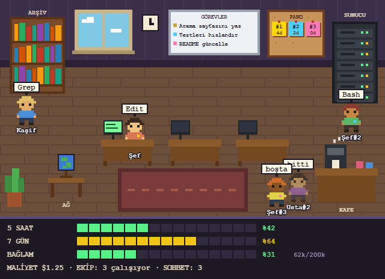

# Piksel Ofis

Claude Code için piksel-art bir ofis paneli. Sohbet yanında açılır; Claude'un ana oturumu
**Şef**, alt ajanları rol adlarıyla (Kaşif, Mimar, Usta…) çalışanlar olarak görünür ve
kullandıkları araca göre ofisteki istasyonlara yürür: kitaplık (okuma/arama), masa
(düzenleme), sunucu (terminal), küre (web), tahta (planlama), kafe (boşta).



## Neler var

- **Aynı anda çalışan sohbetler:** makinedeki bütün Claude sohbetleri aynı ofiste, `#1`,
  `#2` gibi kalıcı numaralarıyla görünür.
- **Pano:** her sohbetin adı (panelden verilir), amacı, son görevleri ve değiştirdiği
  dosyalar. Kapanan sohbetler 24 saat panoda kalır.
- **Sohbetler birbirinden haberdar:** başka bir sohbet çalışırken Claude'a panonun kısa bir
  özeti verilir (yalnız değiştiğinde, token harcamamak için); başka bir sohbetin yakın zamanda
  değiştirdiği dosyanın üzerine körlemesine yazılmaz. `ofis_mesaj` aracıyla sohbetler
  birbirine numarasıyla mesaj atabilir.
- **Görev kutusu:** panelden ekibe görev verilir; dosya yolu ya da son ekran görüntüsü ek
  olarak eklenebilir.
- **Göstergeler:** 5 saatlik ve 7 günlük kullanım limiti, bağlam doluluğu, maliyet.

Her şey yereldir: veriler yalnız `~/.claude/pixel-ofis-live/` altında tutulur, hiçbir yere
gönderilmez.

## Kurulum

Güncel bir Claude Code gerekir (VS Code eklentisi ya da terminal). Mod sistemi Claude
Code'da erken erişimdedir; eklentiyi güncel tutun.

**Windows, çift tıklayarak:** [`kur.cmd`](kur.cmd) dosyasını indirip çalıştırın.

**Claude Code terminalinde:**

```
/plugin install pixel-ofis --marketplace musabhc/pixel-ofis
```

**Komut satırından:**

```
claude plugin install pixel-ofis --marketplace musabhc/pixel-ofis
```

Kurulumdan sonra yeni bir sohbet açın; panel kendiliğinden açılır. Kapatırsanız `/ofis`
yazarak yeniden açabilirsiniz.

## Geliştirme

```
claude plugin validate .
claude plugin test .
```

## Lisans

MIT
