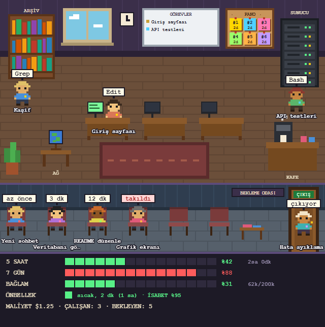

# Piksel Ofis

Claude Code için piksel-art bir ofis paneli. Sohbet yanında açılır; Claude'un ana oturumu
**Şef**, alt ajanları rol adlarıyla (Kaşif, Mimar, Usta…) çalışanlar olarak görünür ve
kullandıkları araca göre ofisteki istasyonlara yürür: kitaplık (okuma/arama), masa
(düzenleme), sunucu (terminal), küre (web), tahta (planlama), kafe (boşta).



## Neler var

- **Aynı anda çalışan sohbetler:** makinedeki bütün Claude sohbetleri aynı ofiste görünür.
  Her sohbetin şefi, Claude Code'un o sohbete verdiği başlığı taşır (sohbeti kendiniz
  adlandırdıysanız o ad).
- **Bekleme odası:** işini bitiren sohbetin şefi ofisin altındaki bekleme odasına geçer ve
  koltukta ne kadar süredir beklediğini gösterir. Yeni görev gelince ofise döner. 30 dakika
  boyunca ilerlemeyen sohbet, penceresi açık kalsa da kapıdan çıkar; ekran açık bırakılmış
  sohbetlerle dolmaz. Kendi panelinizde kendi sohbetiniz hiç çıkmaz.
- **Sohbetler birbirinden haberdar:** başka bir sohbet çalışırken Claude, bir dosyayı
  değiştirdiği anda diğer sohbetlerin kısa bir özetini okur. Yalnızca okuma ya da konuşma
  yapılan turlara bu özet eklenmez. Özet değişmediyse tekrarlanmaz, nasıl mesaj atılacağı da
  sohbet başına bir kez söylenir. Başka bir sohbetin yakın zamanda değiştirdiği dosyanın
  üzerine körlemesine yazılmaz. `ofis_mesaj` aracıyla sohbetler birbirine numarasıyla mesaj
  atabilir.
- **Göstergeler:** 5 saatlik ve 7 günlük kullanım limiti, bağlam doluluğu, prompt önbelleği
  (kafedeki kahve önbellek sıcakken tüter, soğuyunca söner), maliyet.

## Token tasarrufu

- **Pano özetiyle sıkıştırma:** bağlam %60'ı geçince panelde "Pano özetiyle sıkıştır" düğmesi
  çıkar, %70'te bir kez hatırlatılır. Sıkıştırma ister düğmeden, ister `/compact`'tan, ister
  otomatik yapılsın, özetleyiciye sohbetin amacı, son görevleri ve değiştirdiği dosyalar
  söylenir. Böylece özet önemli olanı kaybetmez.
- **Üzerine yazmada fark:** başka bir sohbetin değiştirdiği dosyaya `Write` durdurulduğunda
  Claude'a dosyanın commit edilmemiş değişiklikleri kısa bir `git diff` olarak gösterilir. Ayrıca
  dosyanın tamamını yeniden üretmek yerine `Edit` ile yalnızca kendi değişikliğini yapması
  istenir.
- **Keşif paylaşımı:** bir alt ajanın (Kaşif, Usta…) raporu iki saat boyunca diğer sohbetlerle
  paylaşılır. Başka bir sohbet aynı projede aynı soruyu araştırtmak üzereyse alt ajan
  başlamadan önce bu rapor ona bir kez önerilir. Rapor yetmezse aynı çağrı tekrarlanır ve alt
  ajan başlar.

Her şey yereldir: veriler yalnız `~/.claude/pixel-ofis-live/` altında (panolar, günlükler,
keşifler) ve eklentinin kendi deposunda tutulur, hiçbir yere gönderilmez.

## Kurulum

Güncel bir Claude Code gerekir (VS Code eklentisi ya da terminal). Mod sistemi Claude
Code'da erken erişimdedir; eklentiyi güncel tutun.

**Windows, çift tıklayarak:** [`kur.cmd`](kur.cmd) dosyasını indirip çalıştırın.

**Claude Code terminalinde:**

```
/plugin install pixel-ofis --marketplace musabhc/pixel-ofis
```

**Komut satırından:**

```
claude plugin install pixel-ofis --marketplace musabhc/pixel-ofis
```

Kurulumdan sonra yeni bir sohbet açın; panel kendiliğinden açılır. Kapatırsanız `/ofis`
yazarak yeniden açabilirsiniz.

## Güncelleme

```
claude plugin update pixel-ofis
```

Ardından açık sohbetlerde `/reload-plugins` yazın; yeni sürüm sohbeti yeniden başlatmadan
yüklenir. Eklentiyi kendi klasöründen `CLAUDE_CODE_PLUGIN_DIRS` ile yüklüyorsanız
`~/.claude/settings.json` içindeki `env` bloğuna `"CLAUDE_CODE_PLUGIN_DIR_WATCH": "1"`
ekleyin: VS Code sohbetleri klasördeki değişikliği kendiliğinden yükler. Panel, diskte daha
yeni bir sürüm varken bu sohbetin eski sürümde kaldığını da söyler.

## Geliştirme

```
claude plugin validate .
claude plugin test .
```

## Lisans

MIT
